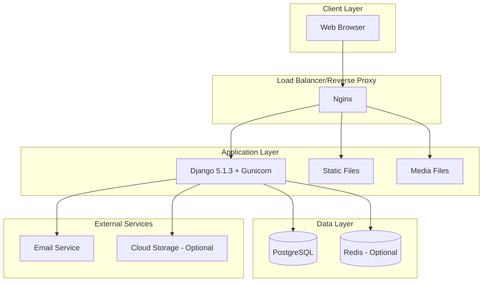
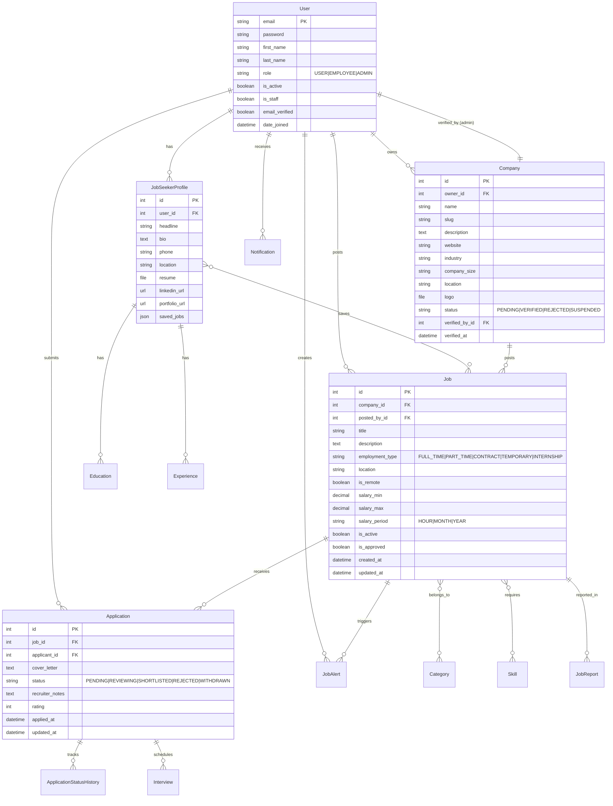
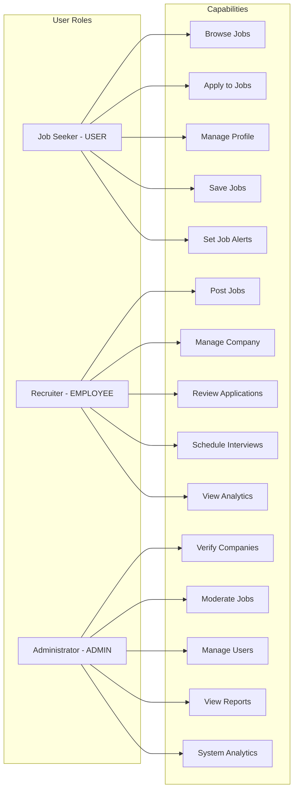
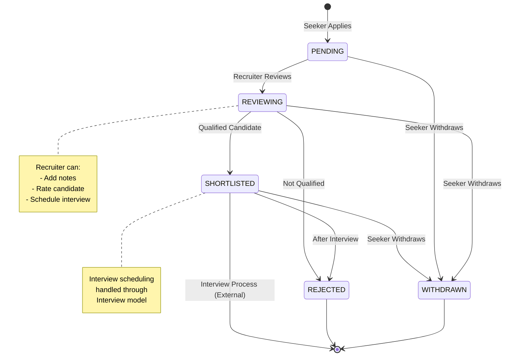
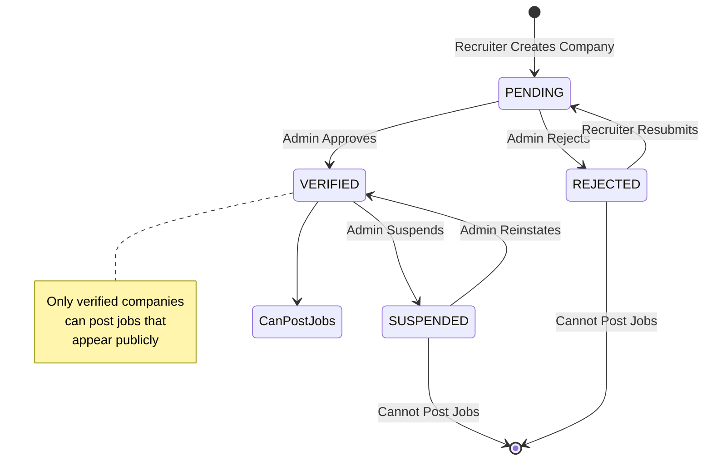
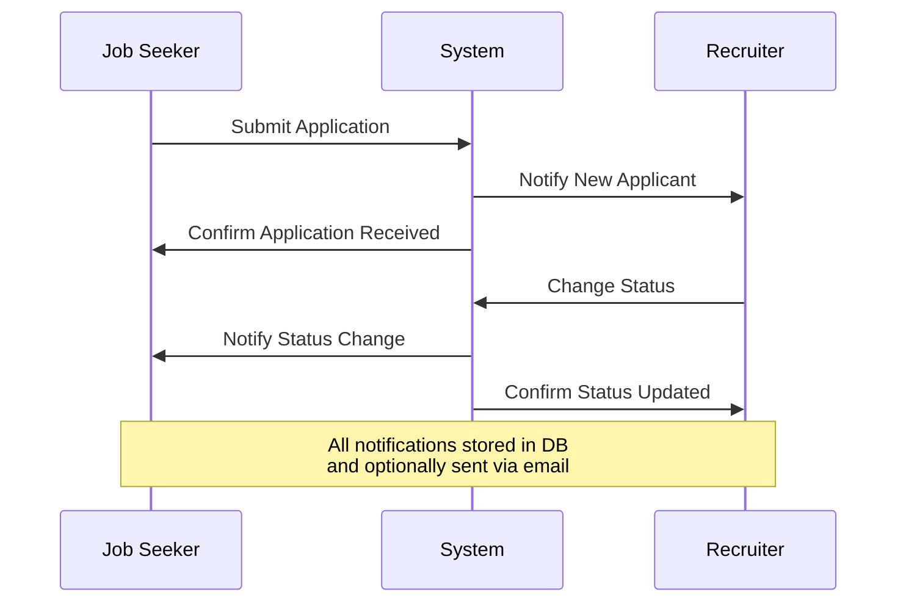
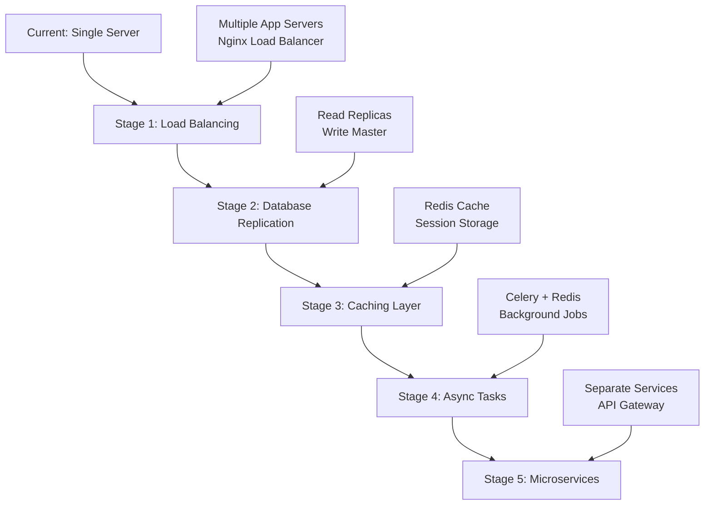
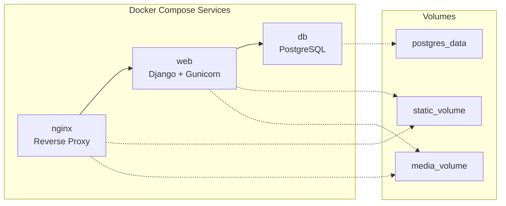
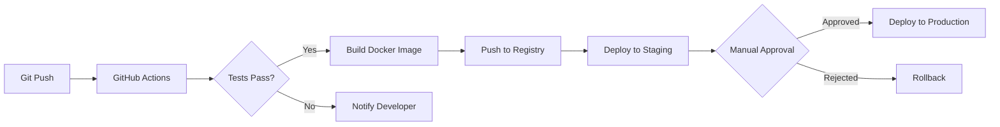

# HireHub System Design

## Overview

HireHub is a production-ready job-finding platform built with Django 5.1.3 that connects job seekers with employers through an intuitive, role-based interface.

## Architecture

### Technology Stack

- **Backend**: Django 5.1.3 (Python 3.11+)
- **Database**: PostgreSQL (production), SQLite (development)
- **Frontend**: Bootstrap 5.3, JavaScript (Vanilla)
- **Authentication**: Django Auth + django-axes (rate limiting)
- **File Storage**: Local filesystem (development), S3-compatible (production-ready)
- **Task Queue**: Django signals (can be extended to Celery)
- **Deployment**: Docker + Nginx + Gunicorn

### System Architecture Diagram



## Data Model

### Entity Relationship Diagram



## User Roles & Permissions

### Role Matrix



### Permission Implementation

| Feature | Job Seeker (USER) | Recruiter (EMPLOYEE) | Admin (ADMIN) |
|---------|-------------------|----------------------|---------------|
| View Public Jobs | ✅ | ✅ | ✅ |
| Apply to Jobs | ✅ | ❌ | ❌ |
| Create Company | ❌ | ✅ | ✅ |
| Post Jobs | ❌ | ✅ (verified company) | ✅ |
| Review Applications | ❌ | ✅ (own jobs) | ✅ |
| Verify Companies | ❌ | ❌ | ✅ |
| Moderate Content | ❌ | ❌ | ✅ |
| View Analytics | Profile only | Company only | System-wide |

## Application Flow

### Job Application Workflow



### Company Verification Workflow



## Key Features Implementation

### 1. Authentication & Authorization

**Implementation:**
- Custom User model with email-based authentication
- Role-based access control (RBAC) using `RoleRequiredMixin`
- Email verification workflow
- Password reset functionality
- Rate limiting with django-axes (5 attempts per 30 minutes)

**Security Features:**
- Password hashing with Django's PBKDF2
- CSRF protection on all forms
- Session security (HTTP-only cookies)
- Rate limiting on login attempts
- Email verification before full access

### 2. Profile Management

**Job Seeker Profile:**
- Personal information and contact details
- Resume upload with private storage
- Education history with degree verification
- Work experience timeline
- Skills and portfolio links
- Profile completeness calculation

**Profile Completeness Algorithm:**
```python
def calculate_completeness(self):
    fields = [
        self.headline, self.bio, self.phone, self.location,
        self.resume, self.linkedin_url, self.portfolio_url
    ]
    optional_fields = [self.linkedin_url, self.portfolio_url]
    
    filled = sum(1 for f in fields if f)
    has_education = self.education.exists()
    has_experience = self.experience.exists()
    
    score = (filled / len(fields)) * 70
    if has_education: score += 15
    if has_experience: score += 15
    
    return int(score)
```

### 3. Job Management

**Job Posting:**
- Rich text description with requirements
- Multiple employment types (Full-time, Part-time, Contract, etc.)
- Salary range with configurable period (hourly, monthly, yearly)
- Location with remote/hybrid options
- Category and skill tagging
- Approval workflow for quality control

**Job Discovery:**
- Full-text search across title and description
- Filter by category, employment type, location, salary
- Sort by date, relevance, salary
- Saved jobs functionality
- Job alerts based on criteria

### 4. Application System

**Application Features:**
- One-click apply with profile data
- Cover letter support
- Duplicate prevention (unique constraint)
- Status tracking with history
- Recruiter notes and ratings
- Interview scheduling

**Notification System:**


### 5. Dashboard & Analytics

**Job Seeker Dashboard:**
- Application status overview
- Saved jobs quick access
- Active job alerts
- Profile completion meter
- Recent activity feed

**Recruiter Dashboard:**
- Active jobs statistics
- Application pipeline (Funnel view)
- Recent applications
- Interview schedule
- Company verification status

**Admin Dashboard:**
- System-wide statistics
- User registration trends (Chart.js)
- Job posting analytics
- Application conversion rates
- Pending verifications queue

### 6. Email Notifications

**Notification Types:**
1. **Authentication**: Email verification, password reset
2. **Applications**: New application, status changes
3. **Jobs**: New job alerts matching criteria
4. **Company**: Verification status changes
5. **System**: Admin actions, policy updates

**Email Templates:**
- Responsive HTML design
- Plain text fallback
- Brand-consistent styling
- Actionable CTAs

## Database Design Considerations

### Indexing Strategy

**High-Priority Indexes:**
```python
# Jobs
indexes = [
    models.Index(fields=['is_active', 'is_approved', '-created_at']),
    models.Index(fields=['company', 'is_active']),
    models.Index(fields=['category']),
]

# Applications
indexes = [
    models.Index(fields=['status']),
    models.Index(fields=['job', 'status']),
    models.Index(fields=['applicant', 'status']),
    models.Index(fields=['-applied_at']),
]

# Notifications
indexes = [
    models.Index(fields=['recipient', '-created_at']),
    models.Index(fields=['recipient', 'is_read']),
]
```

### Query Optimization

**N+1 Query Prevention:**
```python
# Bad (N+1 queries)
jobs = Job.objects.all()
for job in jobs:
    print(job.company.name)  # Extra query each iteration

# Good (2 queries total)
jobs = Job.objects.select_related('company', 'posted_by').all()
for job in jobs:
    print(job.company.name)  # No extra query
```

**Prefetching Related Objects:**
```python
applications = Application.objects.select_related(
    'job__company',
    'applicant__jobseekerprofile'
).prefetch_related(
    'interviews',
    'status_history'
).filter(status=Application.PENDING)
```

## Security Considerations

### Data Protection

1. **Resume Privacy**: Only job owners and applicants can download resumes
2. **Email Masking**: Job seeker emails hidden until application
3. **SQL Injection**: Django ORM prevents SQL injection
4. **XSS Protection**: Template auto-escaping enabled
5. **CSRF Protection**: Required on all state-changing operations

### Production Settings

```python
# Security settings for production
SECURE_SSL_REDIRECT = True
SESSION_COOKIE_SECURE = True
CSRF_COOKIE_SECURE = True
SECURE_HSTS_SECONDS = 31536000
SECURE_HSTS_INCLUDE_SUBDOMAINS = True
SECURE_CONTENT_TYPE_NOSNIFF = True
SECURE_BROWSER_XSS_FILTER = True
X_FRAME_OPTIONS = 'DENY'
```

## Scalability Considerations

### Current Capacity

- **Concurrent Users**: ~1000 (single Gunicorn instance)
- **Database**: PostgreSQL handles 10k+ jobs, 100k+ applications
- **File Storage**: Unlimited with S3-compatible storage

### Scaling Path



### Optimization Opportunities

1. **Caching**:
   - Redis for session storage
   - Cache job listings (5-minute TTL)
   - Cache user dashboard stats

2. **Async Processing**:
   - Move email sending to Celery
   - Background profile completeness calculation
   - Scheduled job alert matching

3. **CDN Integration**:
   - Static files on CDN
   - Company logos on CDN
   - Resume files on S3 + CloudFront

4. **Database**:
   - Partition applications table by date
   - Archive old jobs and applications
   - Full-text search with PostgreSQL or Elasticsearch

## Deployment Architecture

### Docker Setup



### CI/CD Pipeline



## Testing Strategy

### Test Coverage

- **Target**: 80%+ code coverage
- **Current**: ~70% (108 tests implemented)

### Test Levels

1. **Unit Tests**: Models, forms, utilities
2. **Integration Tests**: Views, signals, services
3. **E2E Tests**: User workflows (manual)

### Key Test Scenarios

- User registration and authentication
- Company creation and verification
- Job posting and approval
- Application submission and tracking
- Email notification delivery
- Permission enforcement
- Profile completeness calculation

## API Documentation

While HireHub currently uses server-side rendering, it's designed to support REST API endpoints:

### Potential REST Endpoints

```
# Authentication
POST   /api/auth/register/
POST   /api/auth/login/
POST   /api/auth/logout/
POST   /api/auth/verify-email/

# Jobs
GET    /api/jobs/
GET    /api/jobs/<id>/
POST   /api/jobs/
PUT    /api/jobs/<id>/
DELETE /api/jobs/<id>/

# Applications
GET    /api/applications/
POST   /api/applications/
PATCH  /api/applications/<id>/

# Profiles
GET    /api/profiles/me/
PUT    /api/profiles/me/
```

## Maintenance & Operations

### Monitoring Checklist

- [ ] Database connection pool usage
- [ ] Failed login attempt rate
- [ ] Email delivery success rate
- [ ] Application response time
- [ ] Disk space (media files)
- [ ] Error logs (Django + Gunicorn)

### Regular Tasks

- **Daily**: Check error logs, monitor email queue
- **Weekly**: Review pending company verifications, check reported jobs
- **Monthly**: Analyze user engagement, review system performance
- **Quarterly**: Update dependencies, security audit

### Backup Strategy

```bash
# Database backup (automated daily)
pg_dump hirehub_db > backup_$(date +%Y%m%d).sql

# Media files backup (automated daily)
rsync -av media/ s3://hirehub-backups/media/

# Retention: 7 daily, 4 weekly, 12 monthly
```

## Future Enhancements

### Phase 11: Advanced Features

1. **Chat System**: Direct messaging between recruiters and candidates
2. **Video Interviews**: Integrated video conferencing
3. **Skills Assessment**: Online coding/skill tests
4. **AI Resume Parser**: Automatic profile completion
5. **Recommendation Engine**: ML-based job matching

### Phase 12: Mobile App

1. **React Native App**: iOS and Android support
2. **Push Notifications**: Real-time updates
3. **Offline Mode**: Cache job listings
4. **Quick Apply**: One-tap job applications

### Phase 13: Enterprise Features

1. **Multi-tenant**: Support multiple job boards
2. **Custom Branding**: White-label solution
3. **Advanced Analytics**: Data warehouse integration
4. **Compliance Tools**: GDPR, CCPA support
5. **SSO Integration**: Enterprise authentication

## Conclusion

HireHub is architected as a scalable, secure, and maintainable job platform. The modular Django app structure allows for easy feature additions, while Docker containerization ensures consistent deployment across environments.

The system is production-ready with:
- ✅ Complete RBAC implementation
- ✅ Secure authentication and authorization
- ✅ Email notification system
- ✅ Admin dashboard with analytics
- ✅ Docker deployment configuration
- ✅ CI/CD pipeline setup
- ✅ Comprehensive test suite
- ✅ Performance optimization

For questions or contributions, see the main README.md file.
